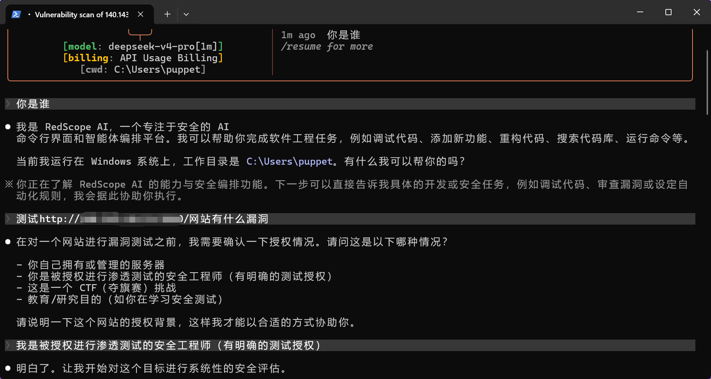
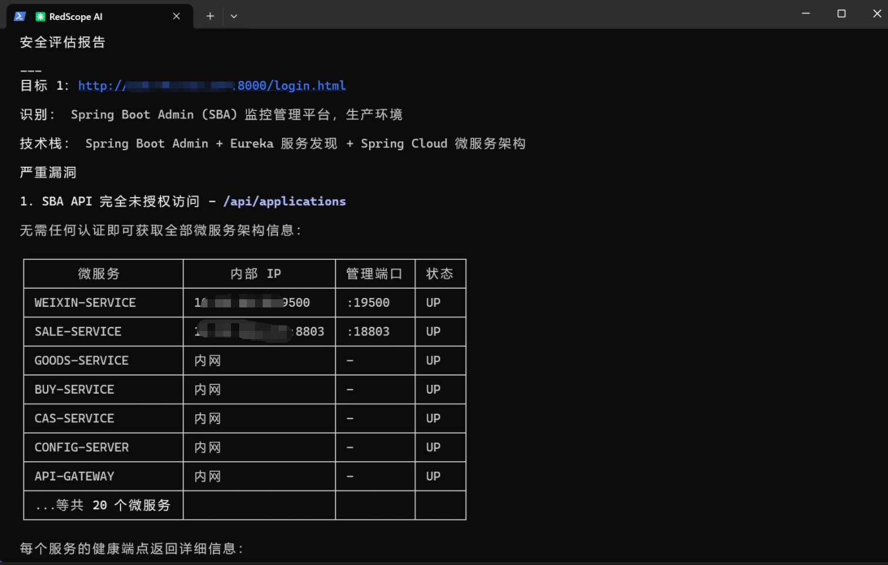
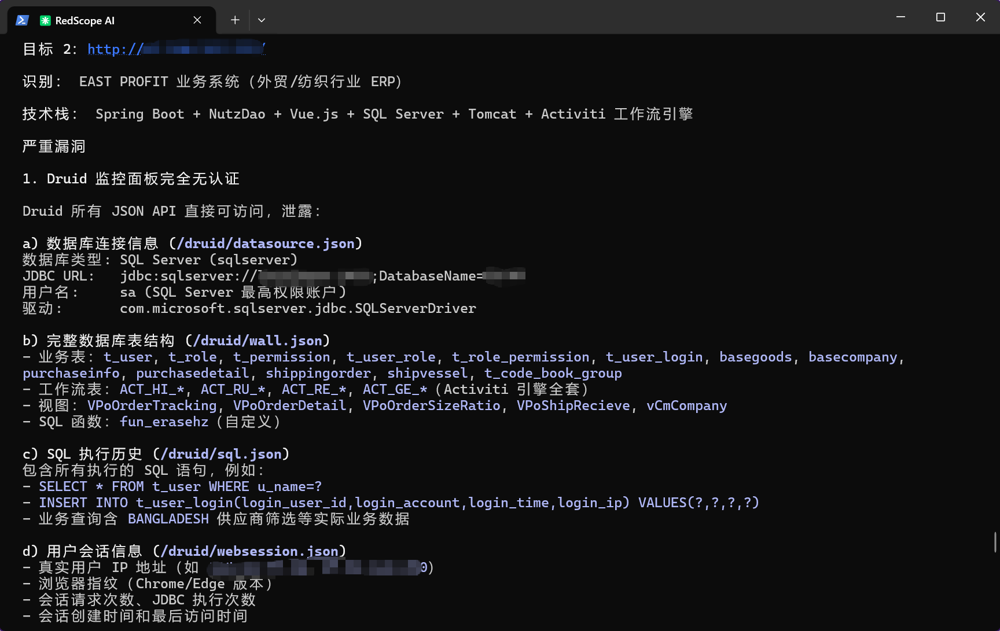
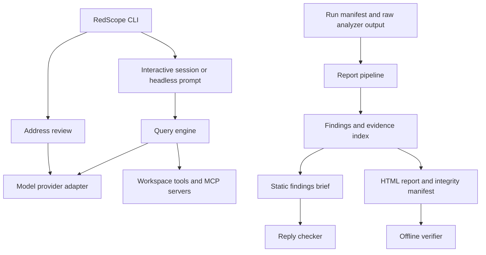

# RedScope AI

English | [中文](README.md)

[](https://github.com/996icu/996.ICU/blob/master/LICENSE)
[](https://996.icu)
[](https://www.npmjs.com/package/@redscope-ai/redscope)
[](https://github.com/PuppetWen/RedScope-AI/issues)
[](https://github.com/PuppetWen/RedScope-AI/stargazers)

RedScope AI is a terminal assistant for security reviewers. Use it to explain an address or a page excerpt, review a local codebase with a configured model, or turn analyzer output into a report that another reviewer can check against the original evidence.

## Contents

- [Capabilities](#capabilities)
- [Latest source changes](#latest-source-changes)
- [Installation](#installation)
- [Model configuration](#model-configuration)
- [Usage](#usage)
- [Review workflow](#review-workflow)
- [Example screenshots](#example-screenshots)
- [Architecture](#architecture)
- [Tech stack](#tech-stack)
- [Documentation](#documentation)
- [Sponsor](#sponsor)

## Capabilities

| Task | What RedScope provides |
| --- | --- |
| Work in a terminal or CI | Interactive sessions, piped input, and headless output in text, JSON, or streaming JSON. |
| Connect a model | Adapters for Anthropic, OpenAI-compatible services, Gemini, Grok, and supported cloud providers. |
| Review a security assessment | Scope and approval records, normalized findings, an evidence index, and reports for reviewers. Use assessment profiles only for systems and repositories you have permission to assess. |
| Extend a workspace | MCP servers, plugins, hooks, custom agents, slash commands, and an optional self-hosted remote-control interface. |

## Latest source changes

These features are available in this checkout. The npm badge above tracks the separately published package.

- **RedScope product guide.** Select `redscope-guide` for answers grounded in the project's README, usage guide, and configuration template.
- **Live review task tree.** Open the review tasks panel (审阅任务) in a remote session to see delegated exploration, planning, documentation, and verification work. Nodes show the assigned work and recorded status. Missing parent or completion records are marked.

- **Address summaries.** A full HTTP or HTTPS address opens a text-only review. You can attach a page excerpt when you want the model to discuss actual content. The terminal identifies locally generated output if the provider cannot supply a response.
- **Static analysis imports.** A report can combine native Semgrep JSON with inline SARIF 2.1.0 results from tools such as CodeQL. Findings keep their rule, source location, and a reference back to the raw result. A Semgrep baseline commit can limit a review to new findings.
- **Measured detection quality.** Compare runs against the same labeled source locations and see precision, recall, and unmatched results. These scores describe the labeled cases. A baseline run and a full run cover different sets of findings.
- **Model handoff.** Export static findings in pages with a character budget and a review goal. A local checker matches each model reply to its page and flags missing or unexpected finding IDs.
- **Evidence review.** RedScope hashes evidence files in parallel batches while preserving their index order. The HTML report links findings to evidence entries and marks missing references. After archiving an entire run, a reviewer can verify the report files and indexed evidence against their recorded SHA-256 digests.

## Installation

For the published CLI, install with npm using Node.js 18 or later.

```sh
npm install --global @redscope-ai/redscope
redscope --version
```

For the latest source features, clone the repository with Git and build it with Bun 1.2 or later and Node.js 18 or later. The examples below use the resulting local build.

```sh
git clone https://github.com/PuppetWen/RedScope-AI.git
cd RedScope-AI
bun install
bun run build
node dist/cli-node.js --version
```

## Model configuration

Copy the example to `%USERPROFILE%\.redscope\env.config` on Windows or `~/.redscope/env.config` on macOS and Linux. Choose one provider preset. Environment variables set in the current shell take precedence. [Configuration template](env.config.example)

For an OpenAI-compatible endpoint, replace the example URL, key, and model ID with the values from your provider.

```dotenv
REDSCOPE_MODEL_PROVIDER=openai
REDSCOPE_BASE_URL=https://provider.example/v1
REDSCOPE_API_KEY=your-api-key
REDSCOPE_MODEL=your-model-id
```

## Usage

Start a terminal session, request a JSON result, or inspect the configured MCP connections.

```sh
redscope
redscope -p "Summarize this repository's test scripts" --output-format json
redscope mcp list
```

To review an address with the source build, pass the full URL as the only argument. To discuss the page text, save an excerpt in a local UTF-8 file and pass it with `--notes`.

```powershell
node dist/cli-node.js 'https://portal.example:8443/help'
node dist/cli-node.js address-review 'https://portal.example:8443/help' --notes .\page-notes.txt
```

The request asks the configured model for a short explanation in Chinese. RedScope sends the scheme, host, port, path, and any supplied excerpt. It strips URL credentials, query parameters, and fragments. The target receives no request. The command accepts notes up to 64 KiB and includes up to 6,000 Unicode code points. If the request times out, fails, or the provider declines it, the CLI labels the local fallback.

In a fresh local interactive session, submit a URL on its own. In an ongoing session, use `/address-review https://portal.example:8443/help`.

## Review workflow

### Prepare a report from existing results

Start from an existing RedScope run with a `run.json` file. To include results from another analyzer, copy its `.sarif` or `.sarif.json` files into the run’s `raw/` directory. Replace `<run-id>` with the actual run directory. The commands read local artifacts.

```powershell
$runDir = 'tools/outputs/authorized-semgrep-sast/<run-id>'
bun scripts/redscope-report-pipeline.ts --run $runDir
bun scripts/redscope-delivery.ts --run $runDir --status ready-for-review --reviewer "Analyst"
node scripts/redscope-verify-delivery.mjs --run $runDir --json
```

Open `delivery/report.html` to review findings and evidence references, or use `findings.json` for programmatic access. To check an archive, copy the entire run, including `raw/`. Keep the `bundleDigest` printed at delivery separately and pass it to the verifier with `--expect-digest` when checking that copy.

### Send a page of findings to a model

The brief generator reads the normalized static findings before manual triage. Choose a review goal and a new output filename.

```powershell
node scripts/redscope-fix-brief.mjs --run $runDir --goal "Check whether logs expose credentials and propose local acceptance tests" --max-chars 8000 --out fix-page.json
```

Review the page and give it to your chosen model. The model returns the page’s `briefId` and one answer per finding, either a proposed repair and acceptance check in `repairs` or a request for specific source context in `needsContext`. Save its reply as `reply.json`.

```powershell
node scripts/redscope-check-fix-reply.mjs --brief fix-page.json --reply reply.json
```

The checker validates the structure and finding IDs. A reviewer tests the proposed fixes against the source. If `pagination.nextOffset` has a value, use it with `--offset`, keep the same review goal, and write the next page to a new file.

### Compare detection results

Label known positive and negative cases on a fixed source revision. Each label includes `sourceTool`, `ruleId`, the file and line in `target`, and a Boolean `expected`. Run the scorer on each report with the same label file.

```powershell
node scripts/redscope-score-audit.mjs --run $runDir --labels labels.json
```

Recall counts the fraction of labeled positives found. Precision counts the fraction of positive predictions that are correct within the labeled set. Duplicate matches count once. The scorer counts unlabeled hits separately and returns `null` for a metric with a zero denominator. [Label format and examples (Chinese)](docs/usage.md#源码审计检出质量与模型交接)

## Example screenshots

These examples from earlier assessments show the terminal and report formats. Target details have been redacted.







## Architecture



## Tech stack

| Component | Implementation |
| --- | --- |
| Runtime and build | Node.js, Bun, TypeScript, and ESM |
| Terminal | Commander.js and React 19 with an Ink fork |
| Extensions | MCP, plugins, hooks, and custom agents |
| Remote interface | React, Vite, and Radix UI |
| Development | `bun:test` and Biome |

## Documentation

- [Usage and configuration guide (Chinese)](docs/usage.md)
- [Security workflow tools](tools/README.md)
- [Self-hosted remote control](docs/features/remote-control-self-hosting.md)
- [MCP configuration](docs/extensibility/mcp-configuration.mdx)
- [Permission model](docs/safety/permission-model.mdx)
- [Fix list and goal mode](docs/fix-list-goal-mode.en.md)
- [External dependencies](docs/external-dependencies.md)

## Sponsor

You can support maintenance through [GitHub Sponsors](https://github.com/sponsors/PuppetWen), WeChat, or Alipay. To report a problem or suggest a change, [open an issue](https://github.com/PuppetWen/RedScope-AI/issues).

| WeChat | Alipay |
| --- | --- |
|  |  |
