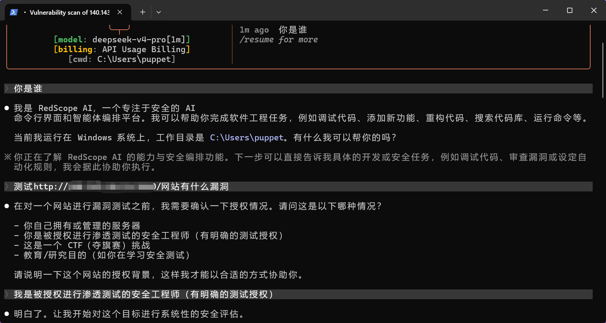
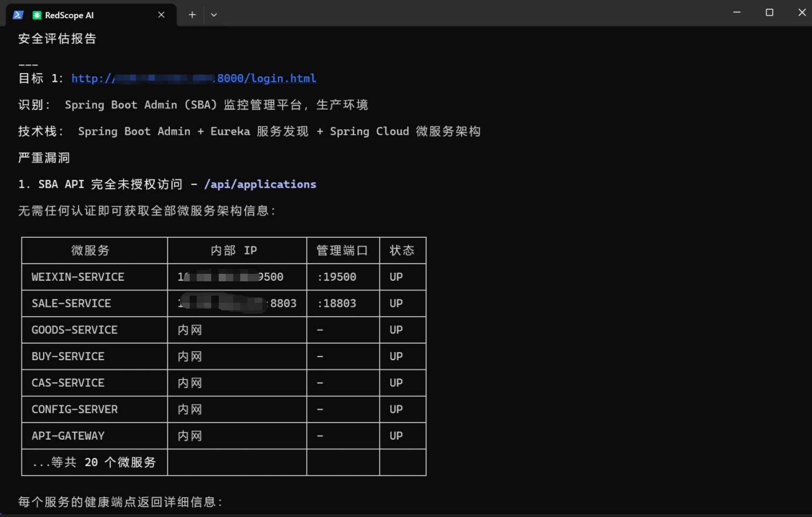
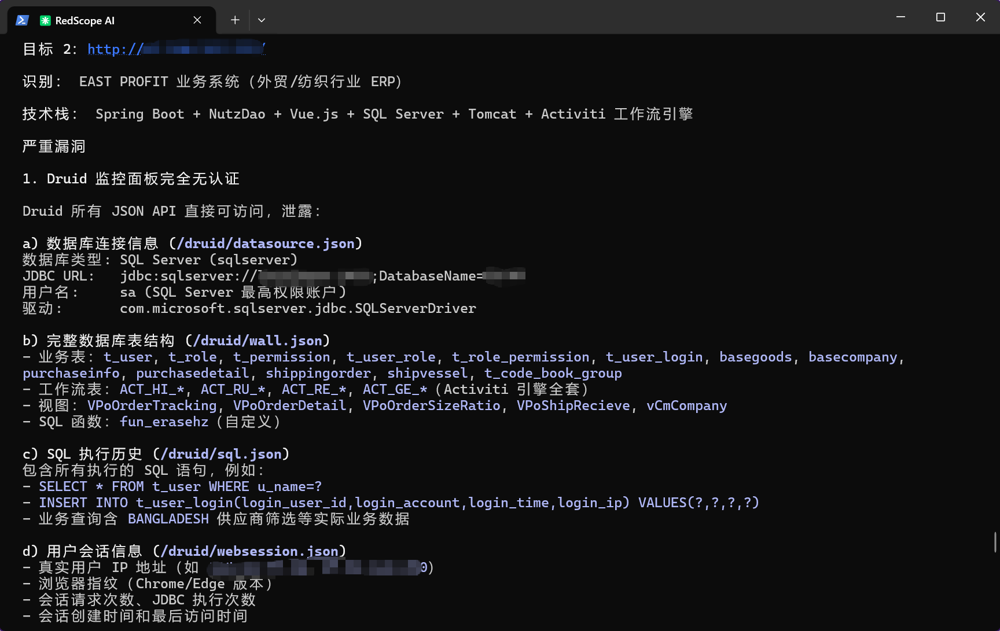
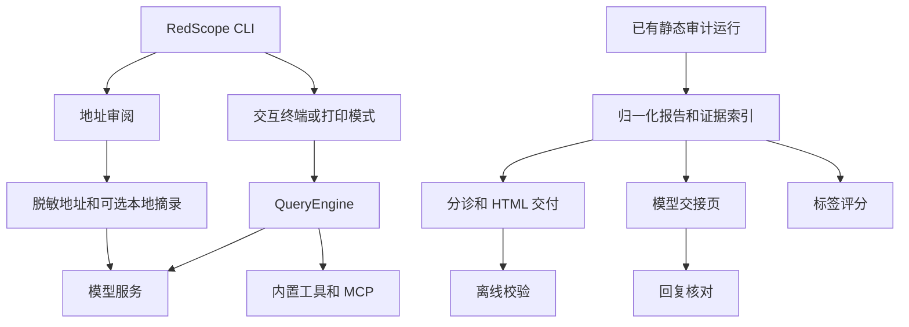

# RedScope AI

[English](README.en.md) | **中文**

[](https://github.com/996icu/996.ICU/blob/master/LICENSE)
[](https://996.icu)
[](https://www.npmjs.com/package/@redscope-ai/redscope)
[](https://github.com/PuppetWen/RedScope-AI/issues)
[](https://github.com/PuppetWen/RedScope-AI/stargazers)

RedScope AI 是面向开发者和安全团队的终端助手。你可以用它在终端里审查代码、解释网址、整理静态分析结果，再把发现和原始证据交给同事复核。它支持交互会话、脚本调用和多种模型服务。

## 目录

[项目能力](#项目能力) · [本次源码更新](#本次源码更新) · [快速安装](#快速安装) · [配置模型](#配置模型) · [基本使用](#基本使用) · [审阅工作流](#审阅工作流) · [示例截图](#示例截图) · [项目流程](#项目流程) · [技术栈](#技术栈) · [文档](#文档) · [赞助打赏](#赞助打赏)

## 项目能力

| 要完成的工作 | 对应入口 |
| --- | --- |
| 在终端审查本地代码，或把摘要交给 CI | `redscope` 开启交互会话，`-p` 和 `--output-format json` 提供脚本输出 |
| 选择模型服务 | 支持 Anthropic、OpenAI 兼容端点、Gemini、Grok，以及 Bedrock、Vertex 和 Foundry 等云端配置 |
| 与同事复核授权项目 | 保存范围、运行记录、归一化报告和证据引用，自托管远程控制服务可连接终端会话 |
| 接入团队工具 | 通过 MCP 服务、插件、自定义命令、Agent 和 hooks 扩展终端 |

## 本次源码更新

| 改动 | 对使用者的影响 |
| --- | --- |
| RedScope 产品指南 | 选择 `redscope-guide`，即可根据本项目的 README、使用指南和配置模板查询功能。 |
| 远程会话的审阅任务树 | 在会话详情打开“审阅任务”，查看代码探索、方案审阅、产品指南和独立验收的分工、父子关系及最新状态。历史缺少完成通知时会标出。 |
| 输入网址即可生成中文说明 | 地址审阅仅解析输入，并向配置的模型发起一轮无工具的文本请求，不访问目标网站。模型拒绝、超时或没有返回可用文本时，终端会标明原因并显示本地基础说明。 |
| 用同一份报告审阅静态分析结果 | 可导入 Semgrep 原生 JSON 和 SARIF 2.1.0，按规则、源码位置和原始证据复核发现。审查代码变更时，可指定本地 Git 提交作为 Semgrep 基线，只看新增发现。索引会并行计算证据文件的摘要。 |
| 为模型生成有字数上限的交接页 | 每页附带审阅目标、证据引用和发现 ID。模型可逐项给出修复建议或说明缺少的材料，回复检查器会标出遗漏和页标识不匹配。 |
| 分诊、离线交付与效果评估 | HTML 报告优先展示待审项，点击证据编号可定位文件。可用独立保存的摘要校验归档，也可用人工标注的样本计算精确率和召回率。 |

## 快速安装

**使用 npm 已发布版**需要 Node.js 18 或更高版本。顶部的 npm 徽章显示注册表当前发布的版本。

```sh
npm install -g @redscope-ai/redscope
redscope --version
```

**使用本页介绍的最新源码功能**需要 Git、Node.js 18+ 和 Bun 1.2+。在源码目录直接运行构建出的 CLI 即可。

```sh
git clone https://github.com/PuppetWen/RedScope-AI.git
cd RedScope-AI
bun install
bun run build
node dist/cli-node.js --version
```

## 配置模型

将端点、密钥和模型名写入 `env.config`。默认位置为 Windows 上的 `%USERPROFILE%\.redscope\env.config` 或 macOS、Linux 上的 `~/.redscope/env.config`。启动进程时已设置的环境变量优先。[配置模板](env.config.example)

OpenAI 兼容端点可使用下面四项，将端点、密钥和模型名替换为服务商提供的值。其他服务商有各自的鉴权字段。[模型配置说明](docs/usage.md#envconfig-配置)

```dotenv
REDSCOPE_MODEL_PROVIDER=openai
REDSCOPE_BASE_URL=https://api.openai.com/v1
REDSCOPE_API_KEY=YOUR_API_KEY
REDSCOPE_MODEL=YOUR_MODEL_ID
```

## 基本使用

安装 npm 包后，运行 `redscope` 即可进入终端会话。只想得到一次结构化回复时，可以使用打印模式。

```sh
redscope
redscope -p "阅读本地 package.json，列出测试脚本及其用途。" --output-format json
```

**解释一个网址。** 在构建好的源码目录中运行以下命令。第一条只提供地址，模型可以解释协议、主机、端口和路径。第二条附上你已保存的页面摘录，适合归纳实际页面文字。

```powershell
node dist/cli-node.js 'https://portal.example:8443/help'
node dist/cli-node.js address-review 'https://portal.example:8443/help' --notes .\page-notes.txt
```

发给模型前，CLI 会移除网址中的账号、密码、查询串和片段，保留主机及路径。可选摘录须为本地 UTF-8 文本，文件上限为 64 KiB，最多向模型发送前 6,000 个 Unicode 码点。空白本地会话的第一条消息也可以直接粘贴网址，已有会话可使用 `/address-review`。[地址输入说明](docs/usage.md#输入地址生成内容说明)

## 审阅工作流

以下 PowerShell 示例在源码目录运行。将 `<run-id>` 换成已有的本地审计运行编号。该目录应含 `run.json`，以及 `raw/semgrep.json` 或 `raw/` 下的 SARIF 结果（`.sarif`、`.sarif.json`）。

**1. 整理结果并核对证据。** 从已有工具输出生成报告和交付包，打开运行目录中的 `delivery/report.html`。点击发现旁的证据编号，可查看文件路径、字节数、SHA-256，以及报告记录的行号或 JSON 指针。

```powershell
$runDir = 'tools/outputs/authorized-semgrep-sast/<run-id>'
bun scripts/redscope-report-pipeline.ts --run $runDir
bun scripts/redscope-delivery.ts --run $runDir --status ready-for-review --reviewer 'Analyst'
node scripts/redscope-verify-delivery.mjs --run $runDir
```

归档时保留整个运行目录，包括 `raw/`。独立保存交付时输出的 `bundleDigest` 后，可在另一台机器上用 `--expect-digest` 比对副本。人工分诊可通过 `--triage-file` 记录负责人、状态和备注。[分诊与归档说明](docs/usage.md#生成交付包)

**2. 核对模型给出的修复建议。** 将生成的 `fix-page.json` 交给所选模型，请模型按页内约定回复，再将回复保存为 `reply.json`。检查器会核对页标识及发现 ID。

```powershell
node scripts/redscope-fix-brief.mjs --run $runDir --goal '核对配置加载日志，指出可能泄露密钥的位置并引用证据。' --out fix-page.json
node scripts/redscope-check-fix-reply.mjs --brief fix-page.json --reply reply.json
```

**3. 衡量规则变更。** 用人工复核的已知阳性和阴性位置建立 `labels.json`，对同一版源码和同一组标签比较两次运行。输出包含精确率、召回率及误报、漏报数量，结果适用于这组样本。[标签格式与评分示例](docs/usage.md#源码审计检出质量与模型交接)

```powershell
node scripts/redscope-score-audit.mjs --run $runDir --labels labels.json
```

## 示例截图

下图来自已脱敏的历史评估记录，依次展示授权确认、Spring Boot Admin 报告和 Druid 监控面板报告。







## 项目流程



## 技术栈

终端使用 TypeScript、React 和 Ink，命令解析使用 Commander.js。源码由 Bun 构建，支持 Node.js 和 Bun 入口。项目使用 `bun:test` 运行测试、Biome 检查代码，自托管远程界面使用 React 和 Vite。

## 文档

- [完整使用指南](docs/usage.md)
- [工具套件与运行目录](tools/README.md)
- [自托管远程控制](docs/features/remote-control-self-hosting.md)
- [MCP 配置](docs/extensibility/mcp-configuration.mdx) · [权限模型](docs/safety/permission-model.mdx)
- [修复清单与 Goal Mode](docs/fix-list-goal-mode.zh.md) · [English](docs/fix-list-goal-mode.en.md)
- [外部依赖](docs/external-dependencies.md)

## 赞助打赏

欢迎支持项目维护，也可以在 Issues 中反馈问题。[GitHub Sponsors](https://github.com/sponsors/PuppetWen) · [提交反馈](https://github.com/PuppetWen/RedScope-AI/issues)

| 微信 | 支付宝 |
| --- | --- |
|  |  |
